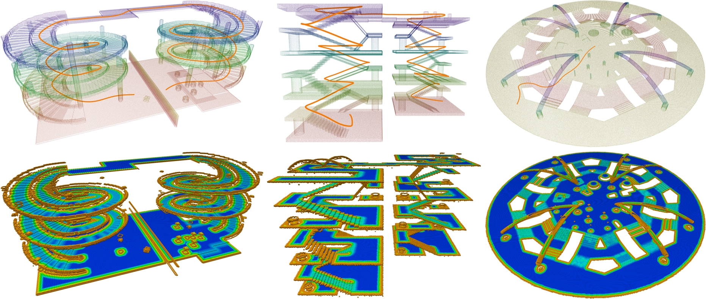

# PCT Planner

## Overview

This is an implementation of paper **Efficient Global Navigational Planning in 3-D Structures Based on Point Cloud Tomography** (accepted by TMECH).
It provides a highly efficient and extensible global navigation framework based on a tomographic understanding of the environment to navigate ground robots in multi-layer structures.

**Demonstrations**: [pct_planner](https://byangw.github.io/projects/tmech2024/)



> **Docs:** [ARCHITECTURE.md](ARCHITECTURE.md) (how it works, navigation representation, code map, learning path) · [SETUP.md](SETUP.md) (build guide, pitfalls) · [PARAMETERS.md](PARAMETERS.md) (all tunable parameters)

## Citing

If you use PCT Planner, please cite the following paper:

[Efficient Global Navigational Planning in 3-D Structures Based on Point Cloud Tomography](https://ieeexplore.ieee.org/document/10531813)

```bibtex
@ARTICLE{yang2024efficient,
  author={Yang, Bowen and Cheng, Jie and Xue, Bohuan and Jiao, Jianhao and Liu, Ming},
  journal={IEEE/ASME Transactions on Mechatronics},
  title={Efficient Global Navigational Planning in 3-D Structures Based on Point Cloud Tomography},
  year={2024},
  volume={},
  number={},
  pages={1-12}
}
```

## Prerequisites

### Environment

- Ubuntu 22.04
- **ROS2 Humble** (ros-humble-desktop-full) — see [ROS2 install guide](https://docs.ros.org/en/humble/Installation.html)
- CUDA 12.x (tested with 12.8)
- CMake >= 3.22, GCC >= 11, Eigen3

> **Note:** The original codebase targeted ROS1 Noetic. This fork has been fully ported to **ROS2 Humble** and tested on Ubuntu 22.04 + CUDA 12.8.

### Python

- Python >= 3.10
- [CuPy](https://docs.cupy.dev/en/stable/install.html) matching your CUDA version (e.g. `cupy-cuda12x`)
- Open3D
- NumPy >= 2.x, SciPy
- Matplotlib (only for `tomography/scripts/visualize_tomogram.py`)

```bash
pip install cupy-cuda12x open3d numpy scipy matplotlib
```

## Build & Install

Inside the package, there are two modules: the point cloud tomography module for tomogram reconstruction (in **tomography/**) and the planner module for path planning and optimization (in **planner/**).

Build the planner module:

```bash
cd planner/
./build_thirdparty.sh   # builds GTSAM 4.1.1 and OSQP from source (~5–10 min)
./build.sh              # builds the pybind11 .so modules
```

> See **SETUP.md** for a full step-by-step guide including common pitfalls and compatibility notes.

## Run Examples — Original Scenes

Four example scenarios are provided:

- **"Clinic"**: a single-storey clinic floor plan (`clinic.pcd`).
- **"Spiral"**: a spiral overpass scenario released in the [3D2M planner](https://github.com/ZJU-FAST-Lab/3D2M-planner) — a five-level helix, the best demo of the multi-layer planner.
- **"Building"**: a multi-layer indoor scenario with various stairs, slopes, overhangs and obstacles.
- **"Plaza"**: a complex outdoor plaza for repeated trajectory generation evaluation.

Each scene is defined in `tomography/config/scene_<name>.py`, which names its point cloud. **The tomogram and trajectory filenames are derived from the PCD filename**, so the stem you pass around is the PCD stem, not the scene name:

| Scene | PCD (`rsc/pcd/`) | Tomogram (`rsc/tomogram/`) |
|-------|------------------|----------------------------|
| Clinic | `clinic.pcd` | `clinic.pickle` |
| Spiral | `spiral0.3_2.pcd` | `spiral0.3_2.pickle` |
| Building | `building2_9.pcd` | `building2_9.pickle` |
| Plaza | `plaza3_10.pcd` | `plaza3_10.pickle` |

Check which clouds are actually present with `python3 run_ros2_interactive.py --list-scenes`.

### Tomogram Construction

Put the point clouds in **rsc/pcd/** (the upstream repo ships the example clouds as `pcd_files.zip`), then run the standalone tomography script — no ROS required:

```bash
cd tomography/scripts/
python3 run_standalone.py --scene Building      # scene name (Clinic/Spiral/Building/Plaza)
```

The generated tomogram is saved to **rsc/tomogram/**.

To inspect what came out, dump every layer:

```bash
cd tomography/scripts/
python3 visualize_tomogram.py --tomo building2_9          # 3D view (default)
python3 visualize_tomogram.py --tomo building2_9 --2d     # per-layer panels
```

### Trajectory Generation

`plan_standalone.py` takes the **tomogram stem** (not the scene name), plus start/end in map coordinates:

```bash
cd planner/scripts/
python3 plan_standalone.py --tomo building2_9 --start -8.2 -3.6 --end 3.6 0.1
```

> Start/end are scene-specific — pick two traversable cells (e.g. from the
> `visualize_tomogram.py` per-layer cost map). Points that land on an obstacle,
> or outside the map, just print `No path found`.

> `plan_standalone.py` has no way to choose a floor, so it always plans from
> slice 0. If the scene's bottom layer has no floor cells (see the `ground_h`
> note below), the resulting trajectory comes out at a sentinel height
> (z ≈ -99.5) and `visualize_tomogram.py` will warn instead of overlaying it.
> Use the interactive node to plan between real floors.

---

## Interactive Planning in RViz2

This fork adds a fully interactive ROS2 workflow where you click start/end points in **RViz2** and the planned path is published live. It works on any scene — pass `--scene` (case-insensitive, default `Clinic`).

### 1. Place your PCD file

The scene config names the file it expects, so drop your cloud under that name (or override it with `--pcd`):

```bash
cp /path/to/your.pcd rsc/pcd/building2_9.pcd
```

### 2. Run tomography (once, or when the scene config changes)

```bash
cd tomography/scripts/
python3 run_standalone.py --scene Building
```

Output: `rsc/tomogram/building2_9.pickle`. Skip this step with `--skip-tomo` if the pickle already exists.

### 3. Launch the interactive node + RViz2

**Option A — two terminals:**

```bash
# Terminal 1: planner node
source /opt/ros/humble/setup.bash
python3 run_ros2_interactive.py --scene Building --skip-tomo

# Terminal 2: RViz2
source /opt/ros/humble/setup.bash
rviz2 -d rsc/rviz/pct_ros2.rviz
```

**Option B — single launcher (RViz2 opens automatically):**

```bash
./launch_ros2.sh --scene Building --skip-tomo
```

`./launch_ros2.sh` forwards all arguments to the node:

```bash
./launch_ros2.sh --scene Spiral --skip-tomo
python3 run_ros2_interactive.py --list-scenes     # what's available / which PCD is present
```

The PCD, tomogram and output trajectory are all derived from the scene config (`<pcd stem>.pickle`, `<pcd stem>_traj.npy`). Override with `--pcd` / `--tomo`.

### 4. Pick start and end points in RViz2

1. Select the **"Publish Point"** tool from the toolbar.
2. **Click** a start location → green sphere appears.
3. **Click** an end location → red sphere appears and planning runs automatically.
4. The planned path appears as a green line on the `/pct_path` topic. The next two clicks start a new query.

> **Click directly on the coloured tomogram layer** for the floor you want — the click's z is used to pick the slice, so the click must land near that floor's height. The view is a 3D orbit camera: drag to rotate, scroll to zoom.

> ⚠️ **`ground_h` must match your point cloud.** `scene_*.py` sets `map.ground_h`, which is used as the map's minimum z and defines `slice_h0`. If it is below the cloud's actual minimum z, the bottom layer ends up with **no floor cells**; planning from it yields a path at a sentinel height (z ≈ -99.5) that looks like it floats far below the map. `visualize_tomogram.py` reports per-layer floor height and flags any layer with no floor cells — run it after generating a tomogram. (The shipped `scene_clinic.py` currently has a stale `ground_h = -13.1` while `clinic.pcd` actually spans z ∈ [-1.05, 4.2].)

### ROS2 Topics

| Topic | Type | Content |
|-------|------|---------|
| `/global_points` | `sensor_msgs/PointCloud2` | Raw point cloud |
| `/tomogram` | `sensor_msgs/PointCloud2` | Traversability layers (intensity = cost) |
| `/pct_path` | `nav_msgs/Path` | Planned trajectory |
| `/pct_marker` | `visualization_msgs/Marker` | Start/end spheres, path waypoints |

---

## Scripts Reference

| Script | Description |
|--------|-------------|
| `run_ros2_interactive.py` | Main interactive ROS2 node. `--scene NAME` picks the scene (default Clinic); subscribes to `/clicked_point`, plans on each start+end pair, publishes path and markers. `--list-scenes` shows availability. |
| `launch_ros2.sh` | Launches `run_ros2_interactive.py` in the background and opens RViz2. Forwards all args (`--scene`, `--skip-tomo`, …). Cleans up both processes on exit. |
| `tomography/scripts/run_standalone.py` | Runs tomography without ROS. Saves pickle to `rsc/tomogram/`. |
| `tomography/scripts/visualize_tomogram.py` | Dumps a saved tomogram: **3D view (default)** — layers drawn at their floor height, colored by cost, with an optional trajectory overlay; `--2d` gives per-layer panels (cost / floor / clearance). `--pcd` also writes a colored point cloud. No ROS/GPU needed. |
| `planner/scripts/plan_standalone.py` | Runs the planner without ROS on a saved tomogram (`--tomo STEM --start X Y --end X Y`). |
| `run_clinic.sh` | Clinic-only convenience wrapper: tomography + planning in one shot (`./run_clinic.sh --ros2 0 0 10 5`). |

---

## Tunable Parameters

See **PARAMETERS.md** for a full reference of all tunable parameters including:
- Agent dimensions (footprint, collision radius, clearance height)
- Climb and step limits (max slope angle, max step height)
- Map resolution and floor-separation settings
- Planner trajectory style and optimizer weights

---

## Compatibility Fixes Applied

The following issues were found and fixed relative to the original repo:

| Issue | Fix |
|-------|-----|
| CUDA 12/13 NVRTC rejects `float16` in kernel preamble | Changed to `float` in `tomography/scripts/kernels.py` |
| ROS2 rejects positional `PointField` constructor args | Changed to keyword args in `tomography/config/prototype.py` |
| Bundled pybind11 2.11 segfaults with NumPy 2.x | Replaced headers with pybind11 3.0.2 in `planner/lib/3rdparty/pybind11/` |
| `tomography/config` and `planner/config` both named `config` (Python import collision) | Loaded via `importlib.util` under unique names in `run_ros2_interactive.py` |
| `libmetis-gtsam.so` / `libgtsam.so` not found at runtime | Preloaded with `ctypes.CDLL(..., RTLD_GLOBAL)` before imports |
| `libgtsam.so.4: undefined symbol: get_thread_reference_vertex` | open3d bundles oneTBB 2021.5 under the same SONAME (`libtbb.so.12`) as the 2022.0.0 GTSAM was built against; glibc reuses whichever loads first. `/usr/local/lib/libtbb.so.12` is now preloaded **before** `import open3d` |
| Optimizer **SIGSEGV** with both `/opt/ros/humble/.../libgtsam.so.4` and the bundled one in the stack | ROS Humble ships GTSAM **4.2.0** and the repo builds **4.1.1**, both with SONAME `libgtsam.so.4`; a sourced ROS env puts its lib dir ahead of RUNPATH, mixing the two. The bundled 4.1.1 is now preloaded by absolute path with `RTLD_GLOBAL` in every Python entry point |
| `rcl_shutdown already called` traceback on Ctrl-C / SIGTERM | `rclpy.shutdown()` was called again after the signal handler already shut down. Switched to `rclpy.try_shutdown()` + catching `ExternalShutdownException` |
| 3D plotting fails with `cannot import name 'docstring' from 'matplotlib'` | Debian's apt matplotlib installs `/usr/lib/python3/dist-packages/mpl_toolkits.pth`, which pre-registers the *old* `mpl_toolkits` in `sys.modules` at startup, so it always beats a newer pip matplotlib. `visualize_tomogram.py` pins `mpl_toolkits` to the directory next to the loaded matplotlib. (Clean fix: `sudo apt remove python3-matplotlib`) |

> See **ARCHITECTURE.md §"环境陷阱"** for the root-cause detail on the dynamic-linking ones.

---

## License

The source code is released under [GPLv2](http://www.gnu.org/licenses/) license.

For commercial use, please contact Bowen Yang [byangar@connect.ust.hk](mailto:byangar@connect.ust.hk).
